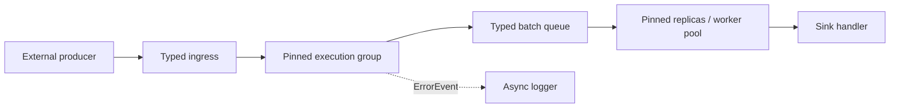

# План реализации типизированного pipeline-фреймворка на Go

## 1. Цель

Создать framework для построения высокопроизводительных batch-oriented data pipelines, близкий по модели исполнения к DPDK Graph:

- граф собирается императивно до запуска;
- topology в первой версии — DAG;
- ноды используют разные статически известные input/output-типы;
- до 8 input-портов и до 8 обычных output-портов;
- служебный error-порт не входит в лимит output-портов;
- scheduler и data plane не используют interfaces, `interface{}`, runtime type assertions или reflection;
- косвенные вызовы через function pointers/closures разрешены;
- steady-state data path работает без аллокаций;
- межгрупповое ожидание выполняется busy-spin без mutex;
- несколько нод могут исполняться одной goroutine; границы групп соединяются batch-очередями;
- порядок после fan-out, параллельной обработки и fan-in не гарантируется.

Минимальная версия должна включать hybrid execution groups, межгрупповые очереди и pinning worker-ов.

## 2. Зафиксированные ограничения

| Область | Решение |
|---|---|
| Go | Минимум Go 1.22 |
| Платформы | Все платформы, поддерживаемые Go |
| Переносимость | Обязательный pure-Go fallback |
| Оптимизации | Разрешены `unsafe`, atomics, assembler и cgo |
| Topology v1 | Только DAG |
| Graph definition | Императивная сборка до запуска |
| Runtime lifecycle | Каждый restart создаёт новый runtime из immutable definition |
| Processing | Только batches; размер конфигурируется |
| Ports | До 8 heterogeneous inputs и 8 heterogeneous outputs |
| Node activation | При наличии batch хотя бы на одном входе |
| Handler invocation | За вызов обрабатывается batch только одного input-порта |
| Input selection | Пользовательская `func(ReadyMask) PortIndex` |
| Outputs | Максимум один batch на каждый output-порт за вызов |
| Ownership | Входной batch переходит ноде; совместимый batch можно move в output |
| Fan-out broadcast | Копирование в отдельные pooled batches |
| Load balancing | Распределение отдельных элементов с формированием pooled batches |
| Pool ownership | Память выделяет framework |
| Pool exhaustion | Batch отбрасывается, drop-метрика увеличивается |
| Clearing | Настраивается для каждого типа пула |
| Queue full | Конфигурируемые `Wait` или `Drop`; `Wait` использует busy-spin |
| Parallelism | Group replicas, node worker pool и element sharding |
| Node state | Отдельный экземпляр на каждую реплику |
| Ordering | Не гарантируется |
| Panic | Не перехватывается |
| Errors | `Result[E]`; политики Drop, typed error-port и async log |
| Logging | Вне data plane |
| Shutdown | Graceful drain с timeout |
| CPU placement | Явный CPU ID для каждой group/replica |
| Affinity fallback | `LockOSThread`; если CPU affinity недоступен — запуск без affinity с warning |
| NUMA | Учитывается в дизайне, реализация откладывается |
| Performance gate | CI проверяет zero allocations |

`T any` используется только как compile-time generic constraint. Он не создаёт interface value, boxing или runtime cast.

## 3. Архитектурная модель



### 3.1 Control plane

Control plane существует только до `Start()` и отвечает за:

- регистрацию typed node definitions;
- создание typed ports;
- соединение портов;
- назначение execution groups и CPU IDs;
- настройку pools, queues, fan-out и error policies;
- DAG validation;
- автоматическое объединение совместимых нод;
- создание immutable graph definition;
- создание нового runtime при каждом запуске.

Для metadata достаточно числовых `NodeID`, `PortID`, `GroupID` и `EdgeID`. Фактические значения `T` в control plane не хранятся, поэтому type erasure не требуется.

Связь создаётся generic-функцией:

```go
// Connect creates a statically typed edge between compatible ports.
func Connect[T any](
    graph *Definition,
    output OutPort[T],
    input InPort[T],
    config EdgeConfig,
) error
```

Несовместимые типы портов должны приводить к compile-time error.

### 3.2 Data plane

Data plane состоит из:

- typed batch pools;
- typed local edges внутри execution group;
- typed concurrent queues между execution groups;
- arity-specific node handlers;
- interface-free scheduler;
- cache-line-isolated metrics;
- bounded event queue для logger-а.

Scheduler хранит только function pointers и числовую scheduling metadata:

```go
type runnable struct {
    poll func() WorkState
}
```

Typed batches захватываются closure-ом конкретной ноды. Scheduler не видит `T`, не выполняет casts и не использует interface dispatch.

## 4. Typed node API

Из-за отсутствия variadic generics API должен иметь фиксированную арность от 0 до 8. Нужны отдельные формы для:

- source-like ingress adapter: 0 inputs;
- `Node1` … `Node8`: от 1 до 8 inputs;
- `Outputs0` … `Outputs8`: от 0 до 8 outputs;
- sink: 1–8 inputs, 0 outputs;
- отдельного typed error-port.

Повторяющиеся объявления следует генерировать внутренним `go generate`; generated Go files коммитятся в репозиторий. Это не codegen пользовательского графа: topology по-прежнему собирается императивно.

Каждый input имеет отдельный handler. Один node-level тип `E` используется всеми handlers этой ноды, поскольку error-порт один и не использует type erasure.

Направление API:

```go
// Handler1 processes one batch received from the first input port.
type Handler1[S, I, O1, O2, E any] func(
    state *S,
    input Batch[I],
    outputs *Outputs2[O1, O2],
) Result[E]

// Result reports either successful processing or a typed processing error.
type Result[E any] struct {
    Value  E
    Failed bool
}
```

Для closure-based state builder нормализует callback в тот же runtime function pointer. Для explicit state handler получает `*S`. Factory вызывается отдельно для каждой group/node replica; затем вызываются `Init`, обработка и `Close` после drain.

Для ноды с несколькими готовыми inputs:

1. scheduler строит `ReadyMask`;
2. пользовательский selector возвращает один `PortIndex`;
3. вызывается handler конкретного порта;
4. максимум по одному batch публикуется на каждый output.

Для одного input selector не вызывается.

## 5. Batch и pools

### 5.1 Batch contract

`Batch[T]` — небольшой value handle над заранее выделенным typed storage:

- `Len` меняется в пределах настроенного capacity;
- размер batch настраивается для конкретного pool/edge;
- enqueue передаёт handle целиком;
- dequeue передаёт ownership downstream;
- handler может move входной batch только в совместимый output того же `T`;
- если input не перемещён, framework возвращает его в исходный pool после handler-а;
- runtime ownership checks не выполняются.

Корректность move/release обеспечивается документацией API, unit tests и fuzz tests.

### 5.2 Pool contract

Для каждого используемого `T` runtime создаёт monomorphized `Pool[T]`:

- все slots и backing arrays выделяются до запуска;
- pool capacity фиксируется конфигурацией runtime;
- exhaustion не инициирует allocation и приводит к drop;
- drop учитывается отдельно по pool/node/edge;
- `ClearOnRelease` настраивается для pool type;
- pointer-containing `T` поддерживается, но при выключенном clearing пользователь принимает риск удержания ссылок.

External producer поддерживает два пути:

1. `Acquire → fill → Commit` без копирования;
2. `Submit([]T)` с копированием в pooled batch.

Для одного external producer ingress использует SPSC-реализацию.

## 6. Edges, fan-out и queues

### 6.1 Local edge

Между нодами одной execution group используется typed single-thread buffer:

- без atomics;
- без channel;
- без mutex;
- публикация batch делает downstream runnable;
- обработка остаётся в той же pinned goroutine.

### 6.2 Remote edge

Между execution groups используется bounded typed queue. Единый контракт не является interface:

```go
// QueueOps defines allocation-free operations for a typed batch queue.
type QueueOps[T any] struct {
    TryPush func(Batch[T]) bool
    TryPop  func(*Batch[T]) bool
    Len     func() uint32
}
```

Built-in реализации:

- SPSC;
- MPSC;
- SPMC;
- MPMC.

Builder выбирает минимально необходимую модель по количеству producers/consumers после раскрытия replicas и worker pools. Пользователь может выбрать встроенную реализацию или передать собственный `QueueOps[T]`.

Queue policy задаётся на edge:

- `Wait`: повторять `TryPush` в busy-spin до полной передачи batch;
- `Drop`: вернуть batch в pool и увеличить drop counters.

Custom queue обязана соблюдать zero-allocation и non-blocking `TryPush/TryPop`; framework не может автоматически доказать выполнение этого контракта.

### 6.3 Fan-out

Поддерживаются два отдельных режима:

- broadcast: framework получает отдельный batch для каждого consumer и копирует элементы;
- distribution: пользовательская typed function выбирает consumer для каждого элемента, после чего framework формирует batch каждого consumer из его pool.

Если pool или queue недоступны, применяется настроенная drop/wait policy. Порядок элементов между consumers и после fan-in не восстанавливается.

## 7. Execution groups и scheduler

### 7.1 Group runtime

Каждая execution group:

- запускается в отдельной goroutine;
- вызывает `runtime.LockOSThread`;
- получает явно заданный CPU ID;
- применяет OS-specific CPU affinity, если платформа это поддерживает;
- иначе продолжает работу только с locked thread и выдаёт warning;
- выполняет busy poll loop;
- обходит runnable nodes через function pointers;
- не использует interfaces, mutex или blocking channel operations.

Platform-specific affinity и fast paths изолируются build tags. Для каждой оптимизированной реализации обязателен pure-Go fallback.

### 7.2 Manual и automatic grouping

Manual placement — hard constraint. Auto grouping объединяет совместимые ноды так, чтобы минимизировать число remote edges.

Алгоритм:

1. раскрыть group replicas, node pools и sharding boundaries;
2. зафиксировать ручные placements;
3. пометить edges, которые обязаны пересекать worker boundary;
4. объединить оставшиеся соседние ноды через union-find;
5. посчитать remote edges и сформировать CPU binding plan;
6. потребовать явный CPU ID для каждой получившейся group/replica.

Если нет manual/parallelism constraints, минимизация числа remote edges закономерно объединит весь DAG в одну group.

### 7.3 Parallelism

После MVP реализуются:

- replication всей execution group на `N` workers;
- worker pool отдельной ноды;
- element-level sharding;
- отдельный node state на каждую replica;
- broadcast copying;
- fan-in без восстановления порядка.

Динамическое изменение числа workers не поддерживается.

## 8. Errors, logging и metrics

### 8.1 Typed errors

Handler возвращает `Result[E]`. Error policy задаётся для ноды и может комбинировать:

- drop входного batch;
- публикацию `E` в отдельный typed error-port;
- преобразование `E` в фиксированный `ErrorEvent` для logger-а.

Error-port:

- не входит в лимит 8 outputs;
- переносит исходный `E`;
- использует typed pool и edge;
- не требует interface или cast.

Logger mapping задаётся typed function:

```go
// ErrorMapper converts a typed node error into a fixed logging event.
type ErrorMapper[E any] func(E) ErrorEvent
```

`ErrorEvent` помещается в bounded logging ring. Logger goroutine находится вне data plane. При заполнении logging ring событие отбрасывается и увеличивается отдельная метрика. Panic внутри handler-а не перехватывается.

### 8.2 Metrics

Встроенные метрики:

- processed/dropped batches;
- processed/dropped elements;
- errors и retries;
- processing time;
- queue depth и high-water mark;
- pool usage и exhaustion;
- worker idle/spin time;
- пользовательские node metrics.

Сбор processing time имеет два режима:

- каждый batch;
- sampling с настраиваемой частотой.

Источник времени передаётся как function pointer, возвращающий timestamp. Метрики размещаются per-worker и выравниваются по cache line. Экспорт и агрегация выполняются control plane.

## 9. Lifecycle

`Definition` immutable после успешного `Build()`. Каждый запуск:

1. создаёт новый runtime;
2. выделяет pools, rings, metrics и node states;
3. вызывает node `Init`;
4. закрепляет workers за threads/CPUs;
5. открывает ingress;
6. запускает processing.

Graceful shutdown:

1. закрыть ingress для новых commits;
2. дождаться завершения уже начатых producer commits;
3. продолжить исполнение DAG до опустошения local/remote queues;
4. дождаться sink handlers;
5. дождаться logger queue в пределах общего timeout;
6. после timeout drop оставшиеся batches/events и обновить метрики;
7. вызвать node `Close`;
8. завершить workers.

Повторный запуск создаёт новый runtime из той же definition.

## 10. Build-time validation

`Build()` должен проверять:

- topology является DAG;
- число обычных inputs/outputs не превышает 8;
- все обязательные порты подключены;
- manual placements непротиворечивы;
- parallelism boundaries имеют queue;
- для каждой group/replica задан CPU ID;
- pool и queue capacities ненулевые;
- для multi-input node задан input selector;
- error policy имеет необходимые error pool/port/logger mappings;
- все sink paths достижимы от ingress;
- graceful drain не зависит от новых ingress batches.

Type compatibility edges проверяется компилятором через `Connect[T]`, а не через runtime validation.

## 11. Структура модулей

```text
batch/       Batch[T], Pool[T], clear policies
graph/       Definition, Builder, typed ports, DAG validation
node/        Node0..Node8, Outputs0..Outputs8, Result[E]
edge/        local typed buffers, fan-out and sharding
queue/       QueueOps[T], SPSC/MPSC/SPMC/MPMC rings
runtime/     groups, runners, poll loop, lifecycle
affinity/    OS/architecture-specific CPU pinning and fallback
metrics/     counters, timers, snapshots, timestamp function
eventlog/    ErrorEvent ring and asynchronous logger
internal/
  genarity/  generator for fixed arities 0..8
  cacheline/ platform cache-line constants and padding
  numa/      reserved topology/allocation metadata
```

NUMA metadata должно присутствовать в pool/group/queue configuration с первой версии, но пока не влиять на allocation или placement.

## 12. Этапы реализации

### Этап 0. Контракты и benchmark harness

- оформить ownership, move, drop, wait и error semantics;
- зафиксировать публичные generic signatures;
- создать benchmark harness для node call, pool, local edge, remote queue и end-to-end DAG;
- добавить `AllocsPerRun` gates.

Критерий: API позволяет описать heterogeneous DAG без `any`, interfaces и casts в data plane.

### Этап 1. Batch memory subsystem

- реализовать `Batch[T]`;
- реализовать preallocated `Pool[T]`;
- добавить per-pool clearing policy;
- реализовать move и automatic release;
- реализовать producer `Acquire/Commit` и copying `Submit`.

Критерий: acquire/process/move/release и pool-exhaustion path дают `0 allocs/op`.

### Этап 2. Typed graph definition

- реализовать typed port handles;
- создать arity generator 0..8;
- реализовать separate input handlers;
- реализовать node factory, explicit state и closure state;
- реализовать `Connect[T]`;
- добавить DAG validation и immutable definition.

Критерий: несовместимые edge types не компилируются; корректный heterogeneous DAG собирается без reflection.

### Этап 3. Single-group executor

- реализовать typed local edges;
- реализовать interface-free `runnable`;
- реализовать ready mask и пользовательский input selector;
- реализовать sink handler;
- добавить processing/drop metrics.

Критерий: multi-input/multi-output DAG работает в одной goroutine с `0 allocs/op`.

### Этап 4. Hybrid MVP

- реализовать `QueueOps[T]`;
- реализовать bounded pure-Go rings;
- автоматически выбирать SPSC/MPSC/SPMC/MPMC;
- реализовать Wait busy-spin и Drop;
- реализовать execution groups;
- реализовать explicit CPU IDs, `LockOSThread` и affinity adapters;
- реализовать graceful drain with timeout.

Критерий первой рабочей версии: два и более pinned execution groups обмениваются typed batches без interfaces/casts и с `0 allocs/op`.

### Этап 5. Errors и observability

- реализовать `Result[E]`;
- добавить отдельный typed error-port;
- реализовать `ErrorMapper[E]`;
- реализовать bounded async logger;
- добавить полный набор metrics;
- добавить full и sampled timing;
- добавить custom timestamp function.

Критерий: success, error-port и logging paths не аллоцируют в steady-state.

### Этап 6. Parallel execution

- group replicas;
- node worker pools;
- отдельные node states;
- element-level sharding;
- broadcast copying;
- unordered fan-in.

Критерий: framework правильно выбирает queue concurrency model после раскрытия parallel topology.

### Этап 7. Auto grouping

- учитывать manual placements как hard constraints;
- минимизировать remote edges;
- формировать group plan до runtime creation;
- требовать CPU binding для каждой автоматически созданной group.

Критерий: auto plan не создаёт лишних межгрупповых очередей относительно заданных constraints.

### Этап 8. Platform fast paths и NUMA preparation

- добавить build-tagged `unsafe`/assembler/cgo variants только после benchmark evidence;
- сохранить pure-Go implementation как fallback;
- добавить NUMA IDs и allocator hooks без активации NUMA behavior;
- подготовить отдельный этап будущего NUMA placement.

## 13. Тестирование

Обязательные наборы:

- compile-time examples для совместимых и несовместимых typed edges;
- unit tests для каждого arity 0..8;
- pool exhaustion, clearing и move semantics;
- fan-out broadcast и element sharding;
- SPSC/MPSC/SPMC/MPMC stress tests;
- fuzz tests graph builder и DAG validation;
- fuzz/property tests для потерь и дублирования batches;
- graceful drain и timeout;
- conditional affinity tests;
- race tests control plane и external producer;
- end-to-end tests с разными input/output types;
- benchmark matrix по batch size, graph width/depth, queue type и group count.

CI performance gate:

- `0 allocs/op` для утверждённых hot-path benchmarks.

Throughput и latency сохраняются как benchmark reports, но не блокируют merge. Следствие: выбранный gate не защищает от CPU-performance regressions, поэтому результаты benchmarks нужно сохранять для ручного сравнения.

## 14. Основные риски

1. **API арности 0..8.** Без generated boilerplate он быстро станет неподдерживаемым.
2. **Большие generic типы.** Копирование крупных `T` или `E` может доминировать над scheduler overhead.
3. **Pointer retention.** Отключённый clearing для pointer-containing `T` удерживает объекты.
4. **Busy-spin.** Wait policy потребляет выделенный CPU постоянно; CPU pinning является частью эксплуатационного контракта.
5. **Custom functions.** Selector, queue ops, timestamp и error mapper могут аллоцировать или блокироваться; framework не может доказать обратное.
6. **Custom queues.** Нарушение memory ordering в пользовательской реализации может повреждать ownership.
7. **Portability.** Affinity, cache-line details и fast paths требуют build-tagged implementations и тестирования по OS/architecture.
8. **Zero-allocation-only gate.** Он не обнаруживает рост instruction count, cache misses или tail latency.

## 15. Рекомендуемый порядок публичных релизов

- `v0.1`: stages 0–4 — typed hybrid DAG, queues, pinning, graceful drain;
- `v0.2`: stage 5 — errors, async logging, complete metrics;
- `v0.3`: stage 6 — replicas, worker pools, sharding, fan-out/fan-in;
- `v0.4`: stage 7 — automatic grouping;
- `v0.5`: stage 8 — validated platform fast paths and NUMA-ready metadata.

До `v1.0` topology остаётся DAG, dynamic scaling отсутствует, а NUMA behavior не активируется.
